<div align="center">

# ⚡ Mixed-Mode CMOS Inverter: 180 nm TCAD

### A CMOS inverter built from two physically simulated 2D MOSFETs, run in Synopsys Sentaurus and in a DEVSIM drift-diffusion model I wrote from scratch

*Instead of fitting a SPICE model, the transistors are solved from Poisson's equation and carrier continuity on a mesh and wired straight into the circuit.*

<br/>


[**Results**](#-results-sentaurus-vs-from-scratch-devsim) · [**How it works**](#-how-mixed-mode-tcad-works) · [**Device design**](#-device-design) · [**Gallery**](#%EF%B8%8F-sentaurus-gallery) · [**DEVSIM engineering**](#-building-a-tcad-solver-from-scratch-11-numerical-bugs) · [**Run it**](#-run-it)

</div>

---

> 🎓 **Academic project:** SDPS Lab (ECE 3144), MIT Manipal. A device-physics and TCAD study, not a calibrated foundry PDK.

## 📌 TL;DR

| | |
|---|---|
| 🧱 **Built** | 180 nm nMOS and pMOS as full 2D TCAD structures: geometry, Gaussian S/D and LDD doping, TiN gates, Si₃N₄ spacers, refined mesh |
| 🔗 **Coupled** | Both devices wired into an inverter in **Sentaurus SDevice mixed mode**, so the circuit KCL and the semiconductor PDEs go into **one Newton solve** |
| 📈 **Measured** | VTC, noise margins, gain, short-circuit current, and propagation / rise / fall delay at a 10 fF load |
| 🔬 **Cross-checked** | The same devices and circuit re-implemented in a **from-scratch DEVSIM drift-diffusion model** (Scharfetter–Gummel, explicit Bernoulli derivatives, compensated summation) |
| 🔁 **Sized** | A pMOS-width sweep in both simulators. Sentaurus found that **Wp/Wn = 2.0 balances the delays** (tpHL 33.26 ps vs tpLH 33.30 ps) |
| 🤖 **Automated** | Pure-Python extractors turn raw Sentaurus `.plt` output into device and inverter metrics |

---

## 🧠 How mixed-mode TCAD works

A SPICE inverter uses compact-model equations (BSIM and similar) with fitted parameters. Here, each transistor is a **meshed semiconductor device**, and Sentaurus adds the circuit equations to the **same Newton system**:

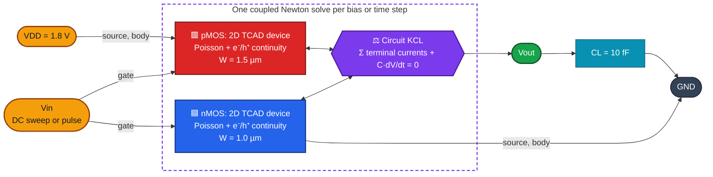

Each device's terminal current, integrated over its contact, enters the KCL of its circuit node. Each node voltage becomes the boundary condition on the contact. **Change the oxide thickness, doping or workfunction and you see the effect on the circuit directly, with no compact model in between.** That's how new technologies are evaluated before any SPICE model exists.

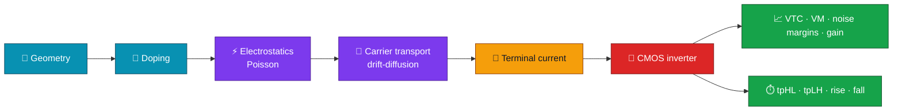

---

## 🧱 Device design

| Parameter | 🟦 nMOS | 🟥 pMOS |
|---|:---:|:---:|
| Channel length | 180 nm | 180 nm |
| Gate oxide | 4 nm SiO₂ | 4 nm SiO₂ |
| Gate | TiN, Φₘ = **4.25 eV** | TiN, Φₘ = **4.97 eV** |
| Spacers | 100 nm Si₃N₄ | 100 nm Si₃N₄ |
| Body | Boron, 3 × 10¹⁷ cm⁻³ | Phosphorus, 3 × 10¹⁷ cm⁻³ |
| Source/drain | Arsenic, 5 × 10¹⁹ cm⁻³, Xⱼ = 120 nm | Boron, 5 × 10¹⁹ cm⁻³, Xⱼ = 120 nm |
| LDD / extension | 5 × 10¹⁸ cm⁻³, Xⱼ = 35 nm | 5 × 10¹⁸ cm⁻³, Xⱼ = 35 nm |
| Width (`AreaFactor`) | 1.0 µm | 1.5 µm (also swept at 2.0 µm) |

The workfunctions are chosen for symmetric thresholds, |Vtn| ≈ |Vtp| ≈ 0.42 V. The pMOS is made wider to make up for lower hole mobility.

**Physics models (Sentaurus):** drift-diffusion · doping-dependent mobility · high-field velocity saturation · Enormal surface mobility degradation · SRH recombination (doping- and temperature-dependent) · Slotboom bandgap narrowing

---

## 📊 Results: Sentaurus vs from-scratch DEVSIM

Both simulators run the same devices and circuit. Before running Sentaurus, I predicted it would show **lower drive current and longer delays** than the DEVSIM model, because Sentaurus adds Enormal mobility degradation and bandgap narrowing. **It did.**

### 🔬 Transistor metrics

| Metric | 🟦 nMOS · Sentaurus | nMOS · DEVSIM | 🟥 pMOS · Sentaurus | pMOS · DEVSIM |
|---|:---:|:---:|:---:|:---:|
| Vt (max-gm) | **0.373 V** | 0.415 V | **−0.409 V** | −0.417 V |
| Subthreshold swing | **75.7 mV/dec** | 74.9 mV/dec | **76.2 mV/dec** | 75.0 mV/dec |
| DIBL | **21.9 mV/V** | 24.1 mV/V | **25.0 mV/V** | 25.1 mV/V |
| Ion | **474.6 µA/µm** | 529.4 µA/µm | **238.6 µA/µm** | 361.7 µA/µm |
| Ioff | **31.7 pA/µm** | 9.6 pA/µm | **4.9 pA/µm** | 5.6 pA/µm |
| Ion / Ioff | **1.5 × 10⁷** | 5.5 × 10⁷ | **4.9 × 10⁷** | 6.4 × 10⁷ |

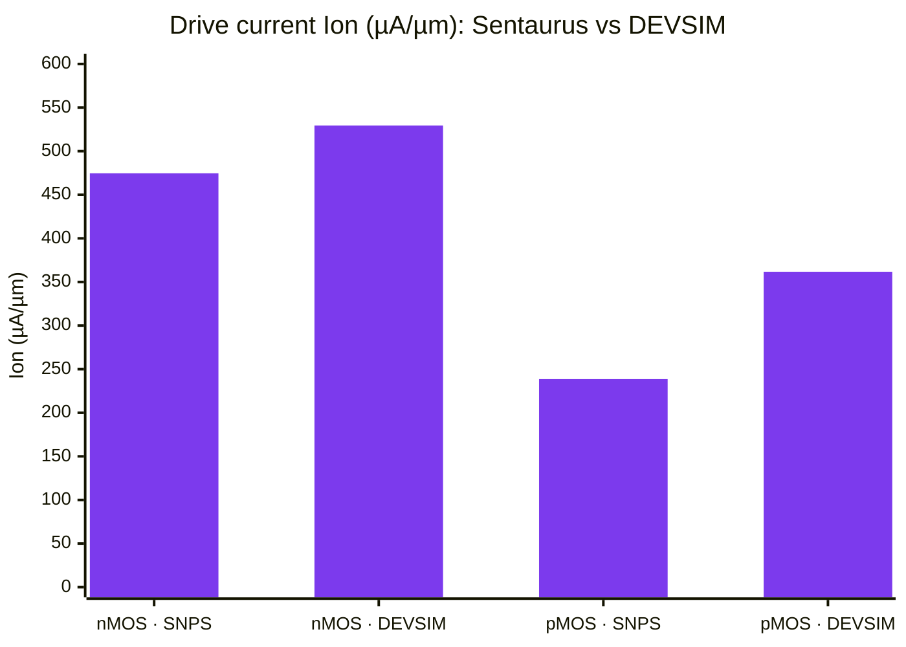

> [!TIP]
> **Reading it:** SS and DIBL agree within a few percent, so the electrostatics match. Ion drops **10% for nMOS but 34% for pMOS** in Sentaurus, because its Enormal surface-mobility model hits holes harder. That one physical effect explains the inverter results below.

### 🔄 Inverter DC (VTC)

| Metric | Sentaurus · Wp = 1.5 | **Sentaurus · Wp = 2.0** | DEVSIM · Wp = 1.0 | DEVSIM · Wp = 1.5 | DEVSIM · Wp = 2.0 |
|---|:---:|:---:|:---:|:---:|:---:|
| Switching point VM | 0.825 V | **0.870 V** | 0.828 V | 0.891 V | 0.935 V |
| VIL / VIH | 0.651 / 0.940 V | **0.712 / 0.997 V** | 0.665 / 0.937 V | 0.750 / 1.016 V | 0.809 / 1.074 V |
| VOH / VOL | 1.665 / 0.147 V | **1.651 / 0.145 V** | 1.671 / 0.146 V | 1.652 / 0.144 V | 1.646 / 0.137 V |
| NML / NMH | 0.504 / 0.725 V | **0.567 / 0.654 V** | 0.519 / 0.734 V | 0.605 / 0.636 V | 0.672 / 0.573 V |
| Peak gain | 18.6 | **17.6** | 19.9 | 19.3 | 20.8 |
| Peak short-circuit IDD | 89.1 µA | **103.6 µA** | 95.1 µA | 118.2 µA | 135.6 µA |

### ⏱️ Inverter transient (CL = 10 fF, 20 ps input edges)

| Metric | Sentaurus · Wp = 1.5 | **Sentaurus · Wp = 2.0** | DEVSIM · Wp = 1.5 |
|---|:---:|:---:|:---:|
| tpHL | 31.43 ps | **33.26 ps** | 27.71 ps |
| tpLH | 41.17 ps | **33.30 ps** | 27.25 ps |
| **Average tp** | 36.30 ps | **33.28 ps** | 27.48 ps |
| 10–90% fall | 48.38 ps | **49.82 ps** | 41.81 ps |
| 10–90% rise | 71.76 ps | **56.59 ps** | 43.65 ps |

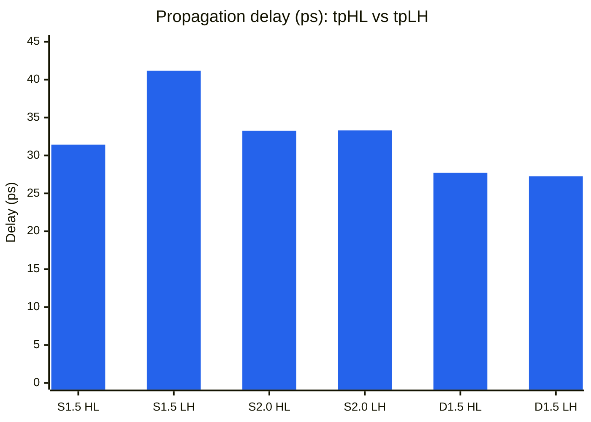
<sub><b>S</b> = Sentaurus, <b>D</b> = DEVSIM, number = Wp/Wn · <b>HL</b> = tpHL (output falling), <b>LH</b> = tpLH (output rising). At S2.0 the two bars are equal.</sub>

### 🎯 What the sizing study shows

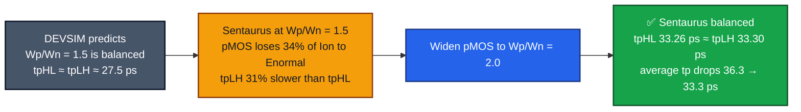

Raising Wp strengthens the pull-up, which moves VM up, balances NML and NMH, and evens out rise and fall. The cost is more short-circuit current and pMOS area. **Which sizing is "right" depends on the physics model,** which is exactly why mixed-mode TCAD is used to evaluate devices before compact models exist.

---

## 🖼️ Sentaurus gallery

<table>
<tr>
<td width="50%" align="center">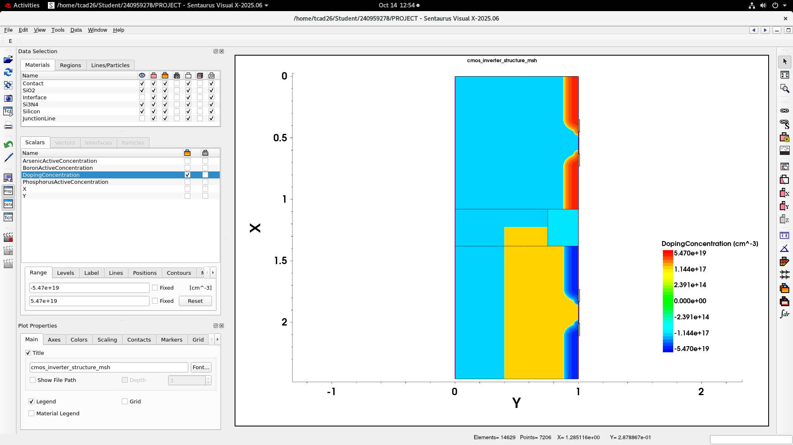<br/><sub><b>Doping concentration</b> of both devices in the inverter (SVisual)</sub></td>
<td width="50%" align="center">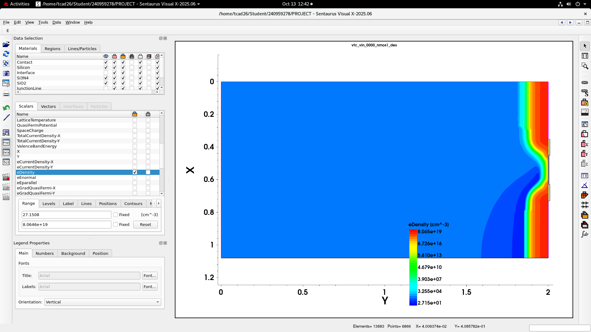<br/><sub><b>Electron density</b> in the nMOS inside the running inverter at Vin = 0.9 V</sub></td>
</tr>
<tr>
<td align="center">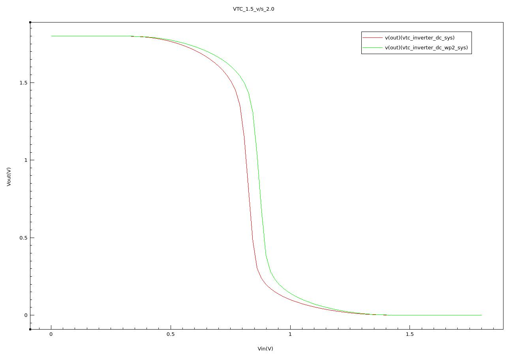<br/><sub><b>VTC</b>: Wp/Wn = 1.5 (red) vs 2.0 (green). VM shifts right as the pull-up gets stronger</sub></td>
<td align="center">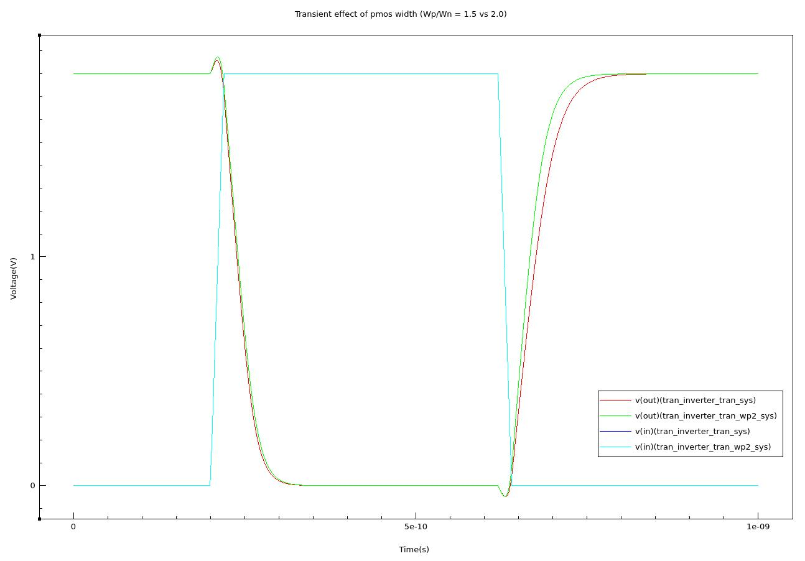<br/><sub><b>Transient</b>: the faster rising edge at Wp/Wn = 2.0, plus Miller overshoot at each edge</sub></td>
</tr>
</table>

<details>
<summary><b>📈 DEVSIM reference plots</b></summary>

<br/>

| | |
|:---:|:---:|
| 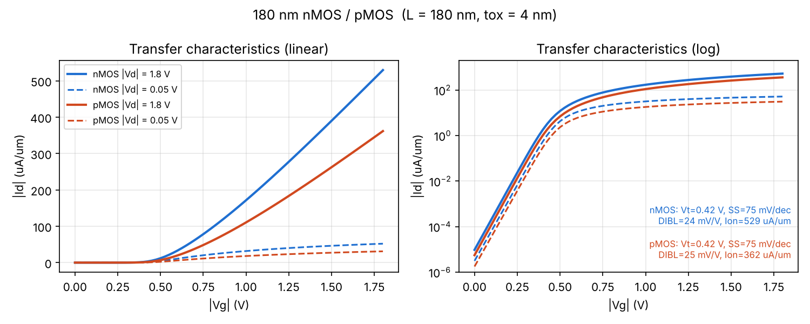 | 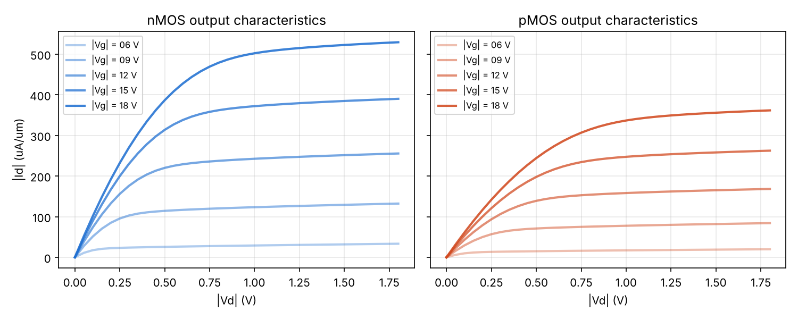 |
| **Id–Vg**, linear and log scale | **Id–Vd**, \|Vg\| = 0.6 → 1.8 V |
| 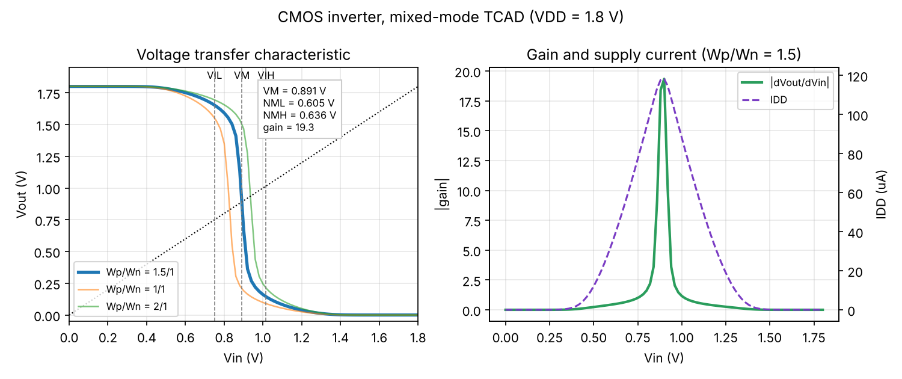 | 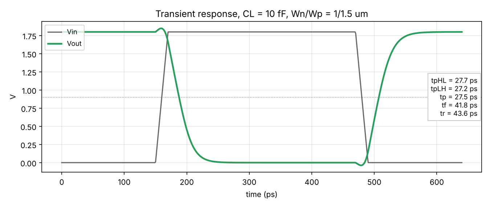 |
| **VTC sizing sweep** | **Transient at 10 fF** |

</details>

> The small spikes above VDD and below 0 at each edge are **Miller feedthrough** through the gate-drain capacitance. A device-level simulation captures this without any extra modelling.

---

## 🔧 Two independent simulation flows

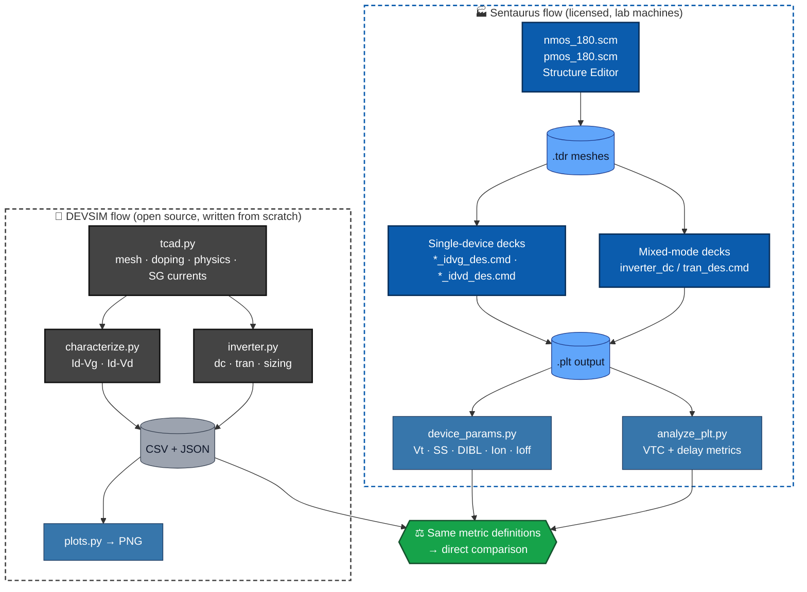

`device_params.py` uses the **same metric definitions** as `characterize.py` (max-gm Vt, constant-current Vt at 100 nA/µm, DIBL from the linear/saturation shift, minimum SS), so the two columns in the results tables are directly comparable. Both extractors are pure Python with no NumPy, so they run on the lab machines as-is.

---

## 🛠️ Building a TCAD solver from scratch: 11 numerical bugs

Sentaurus is only available on lab machines, so I wrote a 2D drift-diffusion MOSFET on **DEVSIM 2.11**. Getting it to converge was the hardest part of the project. Every problem and its fix is logged in [`devsim-notes.md`](devsim-notes.md):

| # | Symptom | Root cause | Fix |
|:---:|---|---|---|
| 1 | Contacts matched 0–1 nodes | DEVSIM 2D contacts must lie on a region boundary | Surround the device with `gas` regions |
| 2 | Doping overflowed (`exp` of +10¹⁰) | Parser binds unary minus tighter than `^` | Write `exp(0 - (y/s)^2)` |
| 3 | `log(0)` at n⁺ contacts | Catastrophic cancellation at N = 5 × 10¹⁹ | Exact form n = nᵢ·exp(asinh(N/2nᵢ)) |
| 4 | Singular Jacobian | Redundant equations at Si/oxide/nitride triple points | Drop side-wall interfaces; pull S/D contacts back 2 nm |
| 5 | Newton diverged at equilibrium | Sign convention of the Poisson node term | Match DEVSIM's `simple_physics` conventions |
| 6 | Linear, not quadratic, convergence | Symbolic `diff()` doesn't differentiate Bernoulli `B()` | Explicit `Bern01` / `Bern10` edge models with hand-written derivatives |
| 7 | Stall at 10⁻⁵ relative error | Cancellation in n₁B(−v) − n₀B(v) | **Kahan-compensated** 3-term sum |
| 8 | Source contact solved to −0.58 V | `ifelse` model cached with the wrong branch | Removed `ifelse`; force-evaluate helper models |
| 9 | Mixed-mode LU divide-by-zero | PARDISO pivoting on O(1) circuit vs O(10⁻¹⁴) device entries | Switch to **UMFPACK** |
| 10 | Empty KCL row at equilibrium | No current flows before drift-diffusion is on | 100 TΩ bleed resistor (≈500× below Ioff) |
| 11 | Circuit error stuck at 10⁻⁷ | Relative error of node voltages near 0 V is noise | 10⁻⁶ relative tolerance (≈1 µV on 1.8 V) |

**The method that cracked most of them:** *bisect against a known-good reference.* DEVSIM's own `simple_physics` solves on the same mesh, so swapping in one piece at a time (parameters, potential equation, contacts, currents) isolated each bug in a few runs.

---

## 🚀 Run it

<details open>
<summary><b>🏭 Sentaurus (lab machine)</b></summary>

<br/>

```bash
# 1. Build the device structures and meshes
sde -e -l nmos_180.scm             # → nmos_180_msh.tdr
sde -e -l pmos_180.scm             # → pmos_180_msh.tdr

# 2. Optional: single-device characterisation
sdevice nmos_idvg_des.cmd && sdevice nmos_idvd_des.cmd
sdevice pmos_idvg_des.cmd && sdevice pmos_idvd_des.cmd
python3 device_params.py IdVg_lin_idvg_nmos_180_des.plt IdVg_sat_idvg_nmos_180_des.plt
python3 device_params.py IdVg_lin_idvg_pmos_180_des.plt IdVg_sat_idvg_pmos_180_des.plt

# 3. Mixed-mode inverter (Wp = 1.5 µm; use the *_wp2_des.cmd decks for Wp = 2.0 µm)
sdevice inverter_dc_des.cmd
sdevice inverter_tran_des.cmd

# 4. Extract metrics
python3 analyze_plt.py dc   vtc_inverter_dc_sys.plt
python3 analyze_plt.py tran tran_inverter_tran_sys.plt
python3 analyze_plt.py list vtc_inverter_dc_sys.plt     # show dataset names

# 5. Inspect the internal device state
svisual nmos_180_msh.tdr
```

</details>

<details>
<summary><b>🐍 DEVSIM reference model (any Linux machine)</b></summary>

<br/>

```bash
pip install devsim numpy matplotlib

python3 characterize.py                       # nMOS + pMOS Id-Vg / Id-Vd → *_params.json
python3 inverter.py dc     --wn 1.0 --wp 1.5  # VTC + DC metrics
python3 inverter.py tran   --wn 1.0 --wp 1.5 --cl 10e-15
python3 inverter.py sizing                    # Wp/Wn sweep
python3 plots.py                              # regenerate the figures
```

Note: the scripts write results to `../results/` relative to the script folder and look for MKL through `DEVSIM_MATH_LIBS`. Mixed mode uses UMFPACK (see bug #9).

</details>

---

## 📁 Repository guide

| Group | Files |
|---|---|
| 🏗️ **Structure (SDE)** | [`nmos_180.scm`](nmos_180.scm) · [`pmos_180.scm`](pmos_180.scm) · `*_msh.cmd` · `*_msh.tdr` |
| ⚙️ **Device decks** | [`nmos_idvg_des.cmd`](nmos_idvg_des.cmd) · [`nmos_idvd_des.cmd`](nmos_idvd_des.cmd) · [`pmos_idvg_des.cmd`](pmos_idvg_des.cmd) · [`pmos_idvd_des.cmd`](pmos_idvd_des.cmd) |
| 🔄 **Mixed-mode decks** | [`inverter_dc_des.cmd`](inverter_dc_des.cmd) · [`inverter_tran_des.cmd`](inverter_tran_des.cmd) · [`inverter_dc_wp2_des.cmd`](inverter_dc_wp2_des.cmd) · [`inverter_tran_wp2_des.cmd`](inverter_tran_wp2_des.cmd) |
| 📤 **Sentaurus output** | `*_sys.plt` (circuit) · `*_des.plt` (device) · `*.tdr` (field snapshots) · `*_des.log` |
| 🧮 **Extractors** | [`analyze_plt.py`](analyze_plt.py) · [`device_params.py`](device_params.py) → `inverter_*_results.txt` · `*_params.txt` |
| 🐍 **DEVSIM model** | [`tcad.py`](tcad.py) · [`characterize.py`](characterize.py) · [`inverter.py`](inverter.py) · [`plots.py`](plots.py) |
| 📊 **DEVSIM results** | `*_idvg.csv` · `*_idvd.csv` · `*_params.json` · `inverter_vtc_wp*.csv` · `inverter_dc_wp*.json` · `inverter_tran_wp1.5.*` |
| 📖 **Docs** | [`THEORY.md`](THEORY.md): viva guide (Poisson/continuity, VTC regions, sizing, Miller effect, likely questions) · [`devsim-notes.md`](devsim-notes.md): numerical debugging log |
| 🖼️ **Evidence** | [`screenshots/`](screenshots): SDE structures, SVisual carrier densities, VTC and transient overlays |

---

## 🧠 Skills demonstrated

<table>
<tr>
<td width="33%" valign="top">

**🔬 Device physics**
- MOSFET electrostatics
- Vt, SS, DIBL, Ion/Ioff extraction
- Mobility degradation, velocity saturation
- SRH, bandgap narrowing
- Workfunction engineering

</td>
<td width="33%" valign="top">

**🏭 TCAD**
- Sentaurus SDE, SDevice, SVisual
- Mixed-mode device + circuit simulation
- Mesh refinement strategy
- DEVSIM from scratch
- `.tdr` / `.plt` workflows

</td>
<td width="33%" valign="top">

**🧮 Numerics & CMOS**
- Newton convergence debugging
- Scharfetter–Gummel discretization
- Floating-point cancellation fixes
- Inverter VTC, noise margins, sizing
- Delay and rise/fall analysis

</td>
</tr>
</table>

---

## ⚠️ Scope

- **Not calibrated to silicon.** Both simulators use textbook model parameters, not a foundry process.
- **2D devices.** Width enters through `AreaFactor`, so narrow-width and 3D edge effects aren't modelled.
- **No PVT corners, Monte-Carlo mismatch or parasitic extraction.** It's a single nominal design point.
- **The DEVSIM model is a reference, not a replacement.** It leaves out Enormal and Slotboom, which is why its Ion and delays differ from Sentaurus as predicted.

---

<div align="center">

**180 nm MOSFETs → drift-diffusion TCAD → mixed-mode CMOS inverter**

Built by **[Siddhant Singh](https://github.com/siddhaantxsingh)** · B.Tech ECE (VLSI Design & Technology), MIT Manipal

<sub>MIT License</sub>

</div>
